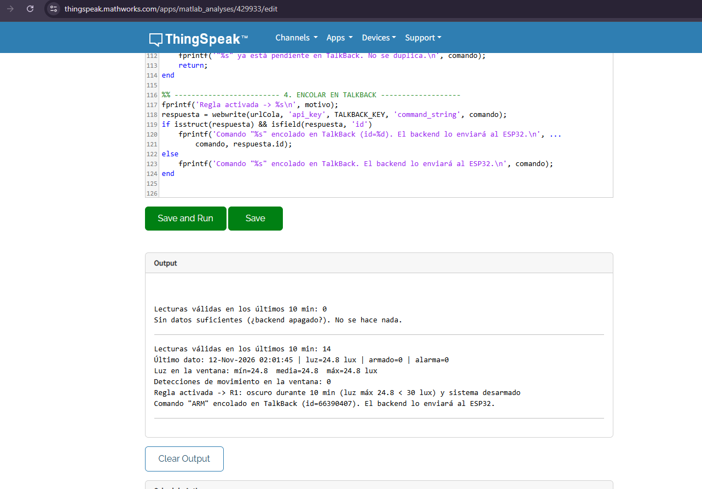
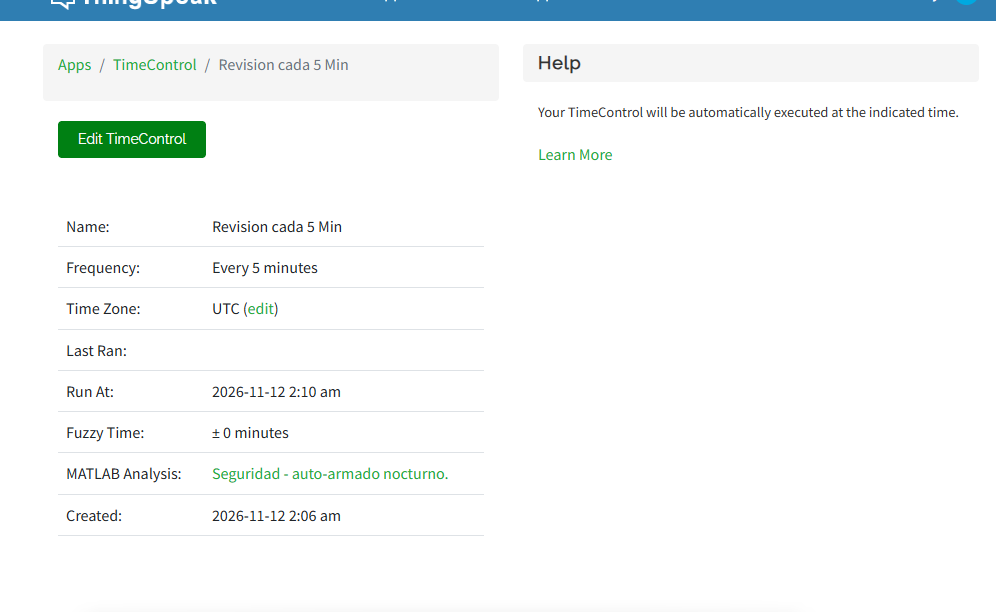
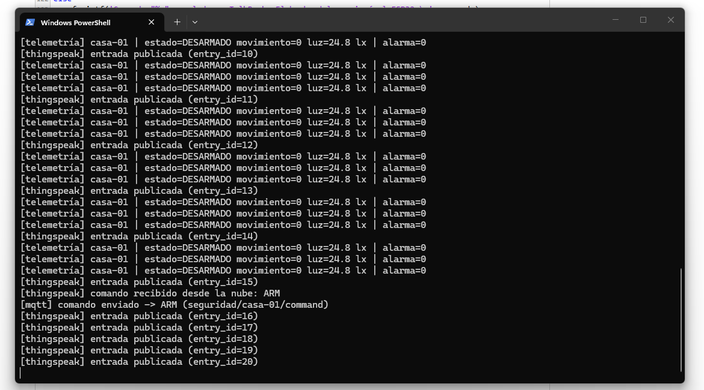
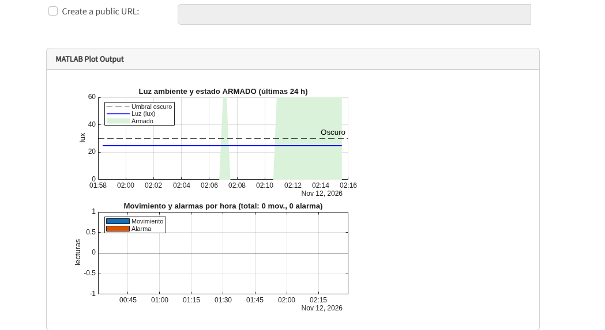

# ☁️ MATLAB en ThingSpeak (extra)

MATLAB **no es requisito del parcial**. El requisito "recepción de comandos
desde la nube" ya se cumple con TalkBack. Estos scripts agregan
**inteligencia en la nube**: ThingSpeak analiza los datos y decide por sí
mismo qué comando enviar al dispositivo.

```
ESP32 ──MQTT──▶ backend ──/update──▶ Canal ThingSpeak
                                          │  (cada 5 min, TimeControl)
                                          ▼
                              automatizacion_talkback.m
                                          │  encola "ARM"
                                          ▼
ESP32 ◀──MQTT── backend ◀──execute── TalkBack
```

| Archivo | App de ThingSpeak | Qué hace |
|---------|-------------------|----------|
| `automatizacion_talkback.m` | MATLAB Analysis + TimeControl | Lee los últimos 10 min del canal y, si estuvo oscuro con el sistema desarmado, encola `ARM` en TalkBack (regla R1). La regla R2, que desarma de día, viene apagada. |
| `visualizacion_historial.m` | MATLAB Visualizations | Gráfica de luz con las franjas en que el sistema estuvo armado, más movimiento y alarmas por hora (últimas 24 h). |

## Requisitos previos

1. El canal y el TalkBack creados como dice `docs/arquitectura.md` §6.
2. El backend corriendo con `THINGSPEAK_TALKBACK_ID` y `THINGSPEAK_TALKBACK_KEY`.
   El backend saca los comandos de la cola y los manda al ESP32.
3. Tener a mano el **Channel ID**, el **Read API Key**, el **TalkBack ID** y el **TalkBack API Key**.

> ⚠️ No subas las claves reales al repositorio. Pégalas solo en la copia
> del script que guardas dentro de ThingSpeak.

## 1. Automatización (MATLAB Analysis)

1. **Apps → MATLAB Analysis → New → Custom (no starter code) → Create**.
2. Nombre: `Seguridad - auto-armado nocturno`.
3. Pega el contenido de `automatizacion_talkback.m`.
4. Rellena la sección **CONFIGURACIÓN** con tus IDs y claves.
5. **Save and Run**. En *Output* verás algo como:
   ```
   Lecturas válidas en los últimos 10 min: 38
   Último dato: ... | luz=12.4 lux | armado=0 | alarma=0
   Regla activada -> R1: oscuro durante 10 min (luz máx 18.2 < 30 lux) y sistema desarmado
   Comando "ARM" encolado en TalkBack (id=...). El backend lo enviará al ESP32.
   ```
6. **Programarlo:** en la misma página, abajo, **Schedule Actions → TimeControl**
   (o **Apps → TimeControl → New TimeControl**):
   - Frequency: **Recurring**, cada **5 minutes**.
   - Action: **MATLAB Analysis** → `Seguridad - auto-armado nocturno`.

### Cómo probarlo en Wokwi

1. Deja el sistema **DESARMADO**.
2. Baja el slider del LDR a menos de 30 lux y espera unos 10 minutos. El
   backend tiene que estar enviando datos a ThingSpeak todo ese rato.
3. Pulsa **Save and Run**, o espera a que corra el TimeControl.
4. En la consola del backend aparece
   `[thingspeak] comando recibido desde la nube: ARM`, y el OLED y el LED
   verde pasan a **ARMADO**.
5. Comprueba la trazabilidad con `python -m backend.queries comandos`. El
   comando aparece con origen `thingspeak`.

Si ejecutas el script otra vez antes de que el backend saque el comando de
la cola, no lo duplica: imprime `"ARM" ya está pendiente en TalkBack`.

## 2. Visualización (MATLAB Visualizations)

1. **Apps → MATLAB Visualizations → New → Custom (no starter code) → Create**.
2. Pega `visualizacion_historial.m`, rellena `CHANNEL_ID` y `READ_KEY` y pulsa **Save and Run**.
3. En **Display Settings** marca **Show on channel** y elige tu canal. La
   gráfica aparece en el dashboard junto a las 4 gráficas de campos.
   Sirve para la captura `05-thingspeak-dashboard.png`.

## Notas

- La ventana de 10 min evita armar por un apagón de luz momentáneo. Con el
  backend enviando cada 15 s, eso son unas 40 lecturas.
- Los umbrales (30 lux y 500 lux) son los mismos de `firmware/config.py`.
- El script solo encola comandos que el backend acepta (`ARM`, `DISARM`),
  según `VALID_COMMANDS` en `backend/config.py`.
- El plan gratuito de ThingSpeak limita el tiempo de cómputo diario de
  MATLAB. Correr cada 5 min queda muy por debajo de ese límite.

## Evidencia (prueba del 11-nov-2026)

Con luz de 24.8 lux y el sistema desarmado, el análisis encoló `ARM`; el
backend lo tomó de TalkBack y el ESP32 pasó a ARMADO. Después, el
TimeControl volvió a armarlo solo tras desarmarlo con el botón.

| | |
|---|---|
| Salida del MATLAB Analysis |  |
| TimeControl cada 5 min |  |
| Backend recibe `ARM` desde la nube |  |
| Gráfica de historial |  |
