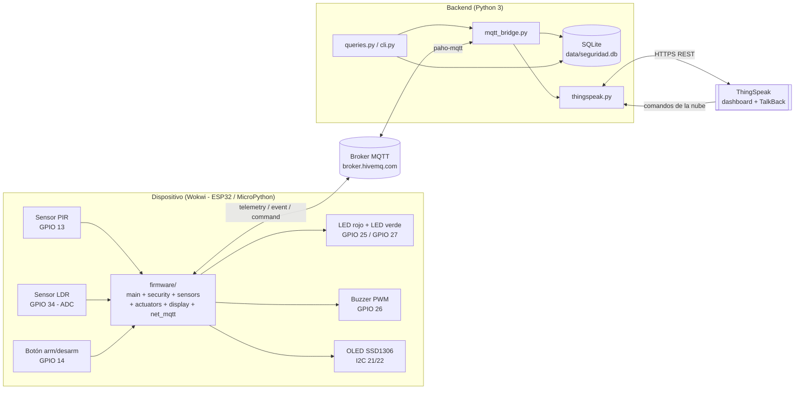
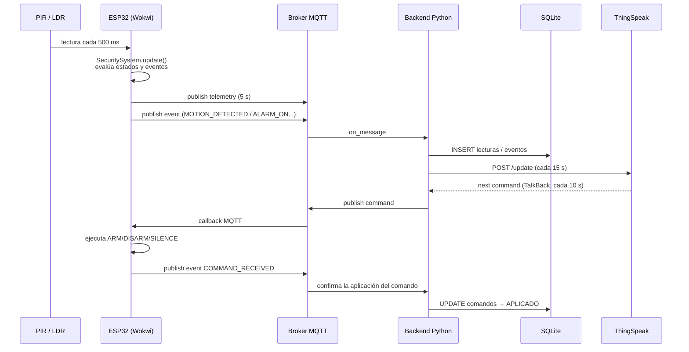
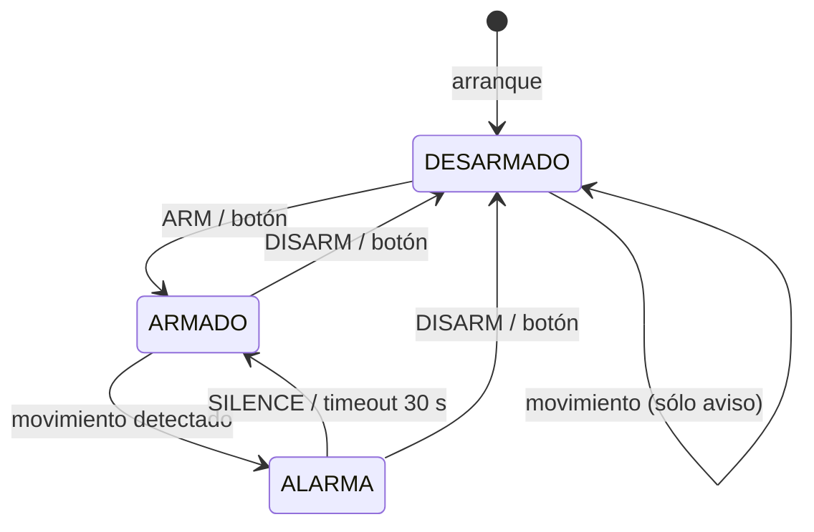
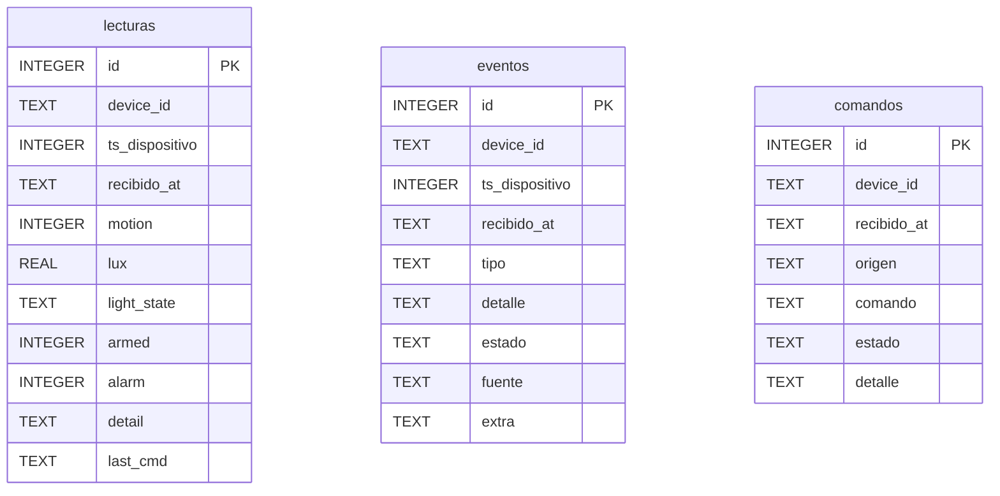

# 📐 Documentación de la arquitectura IoT

**Proyecto:** Sistema de Seguridad — Detección y alertas
**Parcial #2 · Desarrollo de Software VIII · UTP**

Este documento describe la arquitectura del sistema, el flujo de datos,
el modelo de datos y la configuración de la plataforma en la nube.

---

## 1. Arquitectura de componentes



### Responsabilidades por capa

| Capa | Archivo(s) | Responsabilidad |
|------|------------|-----------------|
| Percepción | `firmware/sensors.py` | Leer PIR (digital) y LDR (analógico → lux) |
| Actuación | `firmware/actuators.py` | LED de alarma/estado y buzzer sin bloquear |
| Presentación | `firmware/display.py` | Estado en el OLED SSD1306 |
| Comunicación | `firmware/net_mqtt.py` | WiFi, NTP y cliente MQTT no bloqueante |
| Dominio | `firmware/security.py` | Máquina de estados y generación de eventos |
| Orquestación | `firmware/main.py` | Bucle de muestreo y despacho de comandos |
| Integración | `backend/mqtt_bridge.py` | Suscripción MQTT y envío de comandos |
| Persistencia | `backend/database.py` | Escritura/lectura thread-safe en SQLite |
| Nube | `backend/thingspeak.py` | Dashboard y cola TalkBack |
| Consultas | `backend/queries.py`, `sql/consultas.sql` | Históricos y estadísticas |

---

## 2. Flujo de datos



---

## 3. Contrato de tópicos MQTT

| Tópico | Dirección | Payload | Periodo |
|--------|-----------|---------|---------|
| `seguridad/casa-01/telemetry` | dispositivo → nube | JSON de lecturas | 5 s |
| `seguridad/casa-01/event` | dispositivo → nube | JSON de evento | por evento |
| `seguridad/casa-01/command` | nube → dispositivo | `{"cmd":"ARM"}` o texto plano | bajo demanda |

### Payload de telemetría

```json
{
  "device": "casa-01",
  "ts": 1794222900,
  "state": "ARMADO",
  "armed": 1,
  "alarm": 0,
  "motion": 1,
  "lux": 412.7,
  "light": "NORMAL",
  "detail": "Movimiento detectado en la zona protegida",
  "mqtt": "OK",
  "last_cmd": "ARM"
}
```

### Payload de evento

```json
{
  "device": "casa-01",
  "ts": 1794222901,
  "type": "MOTION_DETECTED",
  "detail": "Movimiento detectado en la zona protegida [entorno oscuro: posible intrusión nocturna]",
  "state": "ALARMA",
  "armed": 1,
  "alarm": 1,
  "source": "pir",
  "lux": 12.4,
  "light": "OSCURO"
}
```

### Catálogo de eventos

| `type` | Significado |
|--------|-------------|
| `SYSTEM_START` | El dispositivo arrancó |
| `ARMED` / `DISARMED` | Se armó / desarmó el sistema |
| `MOTION_DETECTED` | El PIR detectó movimiento |
| `MOTION_IGNORED` | Movimiento con el sistema desarmado |
| `ALARM_ON` | Se activó la sirena y el LED rojo |
| `ALARM_SILENCED` | Alarma silenciada (sigue armado) |
| `ALARM_TIMEOUT` | Alarma apagada sola tras 30 s |
| `COMMAND_RECEIVED` / `COMMAND_UNKNOWN` / `COMMAND_INVALID` | Resultado de un comando |
| `STATUS` / `PONG` | Respuestas a `STATUS` y `PING` |
| `WIFI_ERROR` / `MQTT_ERROR` | Fallos de conectividad |

### Catálogo de comandos

| Comando | Acción |
|---------|--------|
| `ARM` / `ARMAR` | Activa la vigilancia (LED verde) |
| `DISARM` / `DESARMAR` | Desactiva la vigilancia |
| `SILENCE` / `SILENCIAR` | Silencia la alarma, mantiene armado |
| `STATUS` / `ESTADO` | Reporta el estado actual |
| `PING` | Comprueba que el dispositivo responde |

---

## 4. Máquina de estados



---

## 5. Modelo de datos (SQLite)



* **`lecturas`** — una fila por cada publicación de telemetría (históricos).
* **`eventos`** — una fila por cada evento de seguridad.
* **`comandos`** — trazabilidad de los comandos: `ENVIADO → APLICADO | RECHAZADO`.
* **Vistas**: `vista_ultima_lectura` y `vista_alarmas` (consultas frecuentes).

El esquema vive en [`sql/schema.sql`](../sql/schema.sql) (fuente única) y se
aplica automáticamente al iniciar el backend.

---

## 6. Configuración de ThingSpeak

### 6.1 Crear el canal

1. Regístrate en <https://thingspeak.com> → **New Channel**.
2. Nombre: `Sistema de Seguridad IoT`.
3. Habilita 4 campos:

| Campo | Nombre | Descripción |
|-------|--------|-------------|
| Field 1 | Movimiento | 0 / 1 |
| Field 2 | Luz (lux) | iluminación ambiental |
| Field 3 | Armado | 0 / 1 |
| Field 4 | Alarma | 0 / 1 |

4. En **API Keys** copia el `Channel ID`, el **Write API Key** y el **Read API Key**.

### 6.2 Comandos desde la nube (TalkBack)

1. **Apps → TalkBack → New TalkBack** (vinculado al canal anterior).
2. Copia el **TalkBack ID** y el **TalkBack API Key**.
3. En la pestaña **Commands** escribe el comando (ej. `ARM`) y guarda:
   el backend lo toma por REST y lo reenvía al dispositivo por MQTT.

### 6.3 Variables de entorno del backend

```bash
export THINGSPEAK_CHANNEL_ID="1234567"
export THINGSPEAK_WRITE_KEY="XXXXXXXXXXXXXXXX"
export THINGSPEAK_READ_KEY="YYYYYYYYYYYYYYYYYY"
export THINGSPEAK_TALKBACK_ID="987654"
export THINGSPEAK_TALKBACK_KEY="ZZZZZZZZZZZZZZZZZZ"

python -m backend.main
```

| Variable | Uso |
|----------|-----|
| `THINGSPEAK_WRITE_KEY` | habilita el dashboard (POST `/update`) |
| `THINGSPEAK_TALKBACK_ID` + `..._KEY` | habilita los comandos desde la nube |
| `THINGSPEAK_INTERVAL_S` | periodización de actualización (15 s en plan gratuito) |
| `TALKBACK_POLL_S` | frecuencia de sondeo de comandos (10 s) |
| `MQTT_HOST` / `MQTT_PORT` | broker alternativo |
| `SECURITY_DB` | ruta de la base de datos |

Si las claves no están definidas, el backend funciona igualmente en modo
**sólo local** (MQTT + SQLite) y avisa en el arranque.

### 6.4 Automatización en la nube con MATLAB (extra)

ThingSpeak incluye MATLAB, así que la nube también puede **decidir**, además
de mostrar datos. El script `cloud/matlab/automatizacion_talkback.m` corre
como *MATLAB Analysis* cada 5 min (*TimeControl*):

1. Lee los campos 1–4 de los últimos 10 min con `thingSpeakRead`.
2. **Regla R1:** si toda la ventana tuvo luz < 30 lux y el sistema estaba
   desarmado, encola `ARM` en TalkBack (`POST /talkbacks/<id>/commands.json`).
3. No duplica: si el mismo comando ya está pendiente en la cola, no lo
   vuelve a encolar.

El comando sigue el mismo camino que uno escrito a mano. El backend lo saca
con `execute.json`, lo valida contra `VALID_COMMANDS`, lo registra en SQLite
con origen `thingspeak` y lo publica en `seguridad/casa-01/command`. No hubo
que cambiar el backend ni el firmware.

`cloud/matlab/visualizacion_historial.m` agrega al dashboard una gráfica de
luz con las franjas en que el sistema estuvo armado, más los eventos por
hora. Los pasos están en `cloud/matlab/README.md`.

---

## 7. Decisiones de diseño

1. **Todo no bloqueante.** El firmware usa `check_msg()` en lugar de
   `wait_msg()` y temporizadores por `ticks_ms()`, de modo que la lectura de
   sensores nunca se congela esperando la red.
2. **Orientado a eventos.** Las transiciones de estado generan eventos
   (`emit()`) que se publican por MQTT y se persisten: el mismo mecanismo
   alimenta el dashboard, la base de datos y la trazabilidad.
3. **Capas con una sola responsabilidad.** Sensores, actuadores, display,
   red y dominio viven en archivos independientes y comunicados por
   interfaces pequeñas (`snapshot()`, `emit`, `handle_command`).
4. **Backend independiente del hardware.** Gracias a `tests/simulador_dispositivo.py`
   se puede validar toda la cadena sin Wokwi.
5. **Cada proceso MQTT con `client_id` distinto**: si dos clientes comparten
   identificador, el broker expulsa la sesión anterior y se pierden mensajes.
6. **Defensa en profundidad.** Si falta el display, el WiFi o el broker, el
   sistema degrada con mensajes claros en lugar de detenerse.
